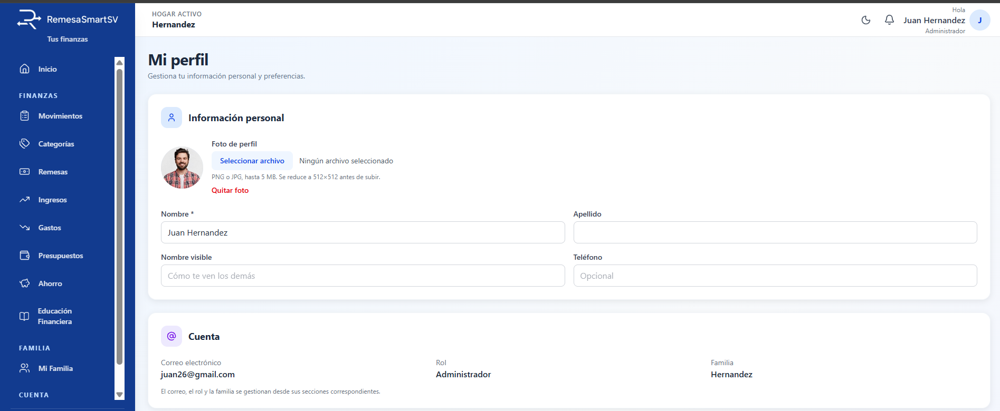
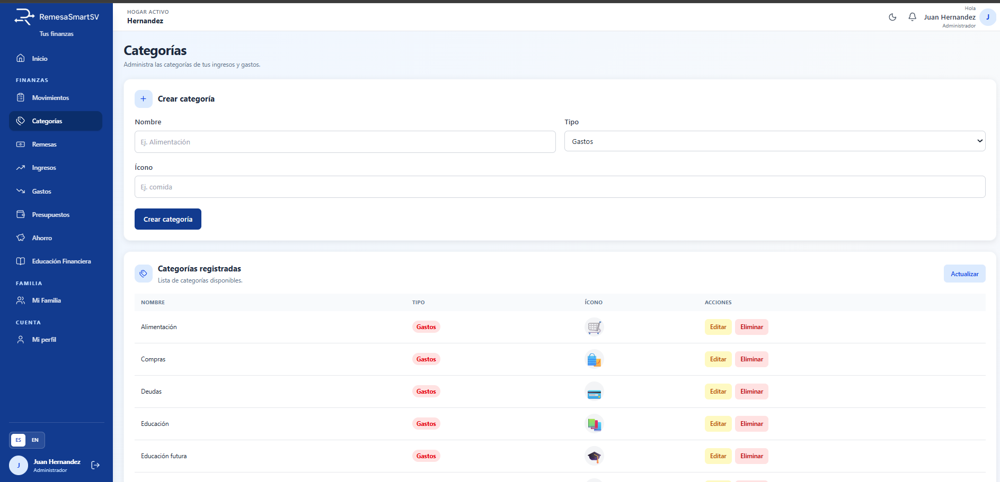
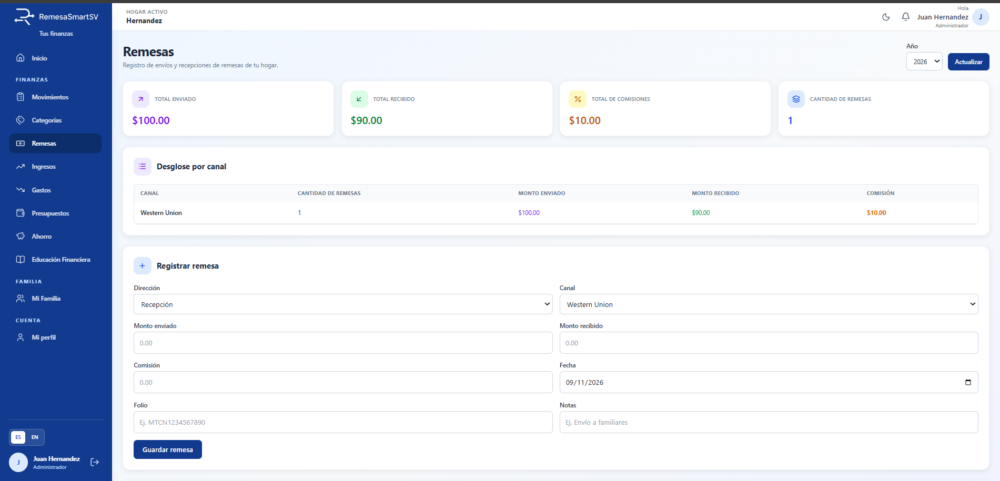
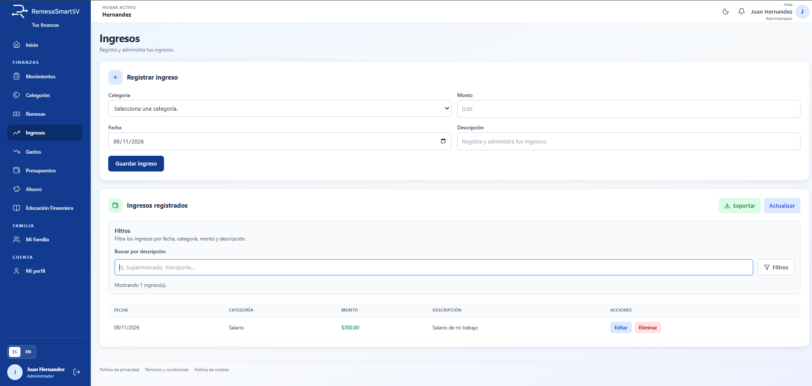
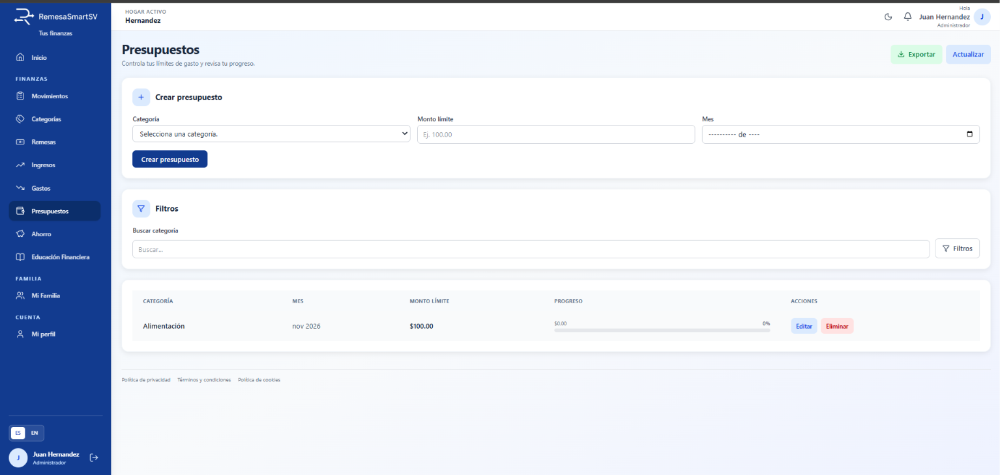
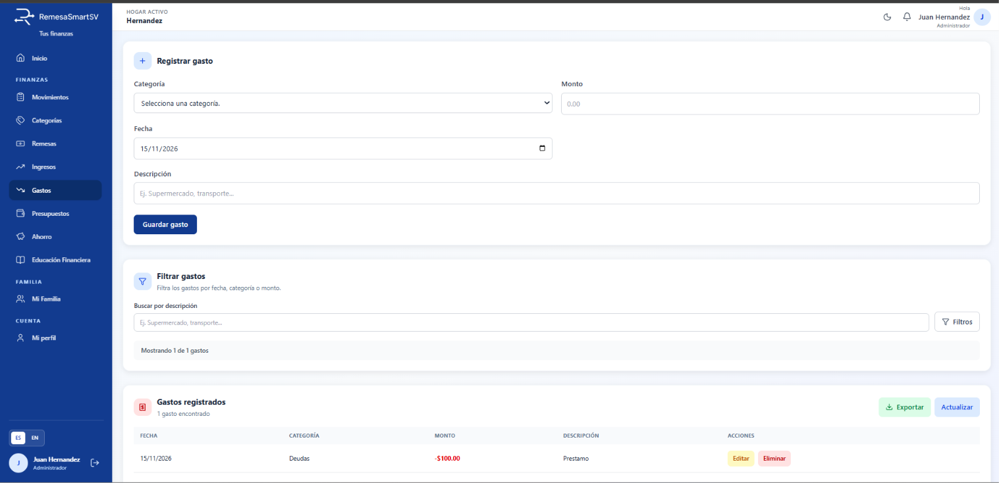
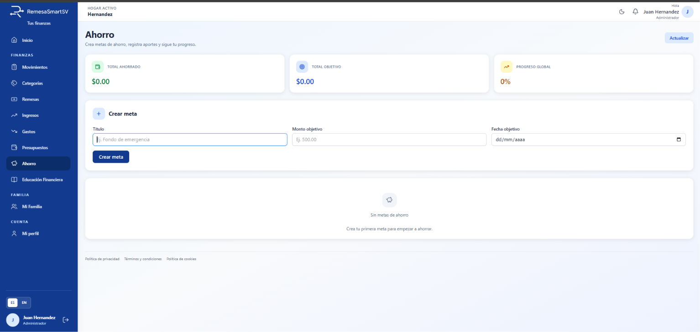

# Manual de Usuario — Plataforma RemesaSmart SV

Bienvenido a **RemesaSmart SV**, el sistema integral de gestión financiera familiar diseñado para administrar el ingreso de remesas, controlar los gastos del hogar, planificar presupuestos mensuales y alcanzar metas de ahorro de manera estructurada.

Este documento detalla paso a paso el funcionamiento de cada módulo de la plataforma, sus reglas de validación y las herramientas disponibles para los miembros del hogar.

---

## 1. Acceso y Autenticación en el Sistema

Para ingresar a las herramientas financieras de **RemesaSmart SV**, todo usuario debe contar con una cuenta personal autenticada y vinculada a su núcleo familiar. En la esquina superior derecha de las pantallas de acceso encontrarás el selector de idioma (**Español / English**) para cambiar el lenguaje de la interfaz en cualquier momento.

### 1.1 Registro de una Cuenta Nueva

Si ingresas por primera vez a la plataforma, debes crear tu perfil de usuario desde la pantalla de registro:

1. En la ventana de inicio de sesión, haz clic en el enlace inferior **«Regístrate»** (o **«Crear cuenta»**) para abrir el formulario de alta.
2. Completa todos los campos obligatorios solicitados en la tarjeta de registro:
   * **Nombre:** Escribe tu nombre y apellido completos.
   * **Correo electrónico:** Ingresa tu dirección de correo personal. Por política de seguridad e integridad de la plataforma, **únicamente se admiten correos con dominio `@gmail.com`**. Si intentas registrar un correo de otro proveedor, el sistema bloqueará el envío e indicará el requisito en pantalla.
   * **Contraseña:** Define una clave de acceso segura que contenga como **mínimo 6 caracteres**.
   * **Confirmar contraseña:** Repite exactamente la misma contraseña anterior para descartar errores de digitación.
3. Haz clic en el botón principal **Crear cuenta**. El sistema validará tus datos, creará tu perfil e iniciará tu sesión automáticamente.
4. **Registro rápido con Google:** Si prefieres no llenar el formulario manualmente, haz clic en el botón inferior **Continuar con Google**. El sistema verificará tu cuenta de Google, creará tu usuario automáticamente si aún no existe y te dará acceso inmediato.

---

### 1.2 Inicio de Sesión y Recuperación de Contraseña

Cuando ya dispones de una cuenta registrada en la plataforma:

1. Ingresa tu **Correo electrónico** (recuerda que debe ser tu cuenta `@gmail.com`) en el primer campo.
2. Escribe tu **Contraseña**. Puedes hacer clic en el ícono del **ojo** situado a la derecha del campo para mostrar u ocultar los caracteres escritos y verificar que no haya errores.
3. Presiona el botón azul **Iniciar sesión** (o utiliza el botón **Continuar con Google** en la parte inferior).
4. **¿Olvidaste tu contraseña?:**
   * Si no recuerdas tu clave de acceso, haz clic en el enlace **«¿Olvidaste tu contraseña?»** ubicado justo debajo del campo de contraseña.
   * La tarjeta cambiará automáticamente al formulario de restablecimiento sin sacarte de la página.
   * Ingresa tu correo `@gmail.com` registrado y presiona **Enviar enlace**. Recibirás las instrucciones para configurar una nueva clave; para regresar a la pantalla anterior, pulsa el botón **Volver**.

---

## 2. Navegación General y Configuración de Mi Perfil

### 2.1 Estructura del Menú Lateral y Barra Superior

Una vez dentro del sistema, la interfaz se divide en un área de trabajo principal a la derecha y una barra de navegación lateral (**Sidebar**) de color azul institucional a la izquierda:

* **Indicador de Hogar Activo:** En la parte superior de la pantalla de trabajo se muestra permanentemente el nombre del núcleo familiar al que perteneces (por ejemplo, **HOGAR ACTIVO: Hernandez**).
* **Secciones del Menú Lateral:**
  * **Inicio:** Panel principal con el resumen general de las finanzas del hogar.
  * **Bloque FINANZAS:** Agrupa los módulos operativos del sistema: *Movimientos*, *Categorías*, *Remesas*, *Ingresos*, *Gastos*, *Presupuestos*, *Ahorro* y *Educación Financiera*.
  * **Bloque FAMILIA:** Acceso a la administración de los integrantes del hogar (*Mi Hogar*).
  * **Bloque CUENTA:** Acceso directo a la configuración de *Mi perfil*.
* **Pie del Menú:** En la zona inferior del menú lateral dispones del selector rápido de idioma, tu avatar, tu nombre con el rol asignado (*Administrador* o *Miembro*) y el botón de salida para **Cerrar sesión**.

---

### 2.2 Gestión de Mi Perfil, Apariencia y Seguridad

Al seleccionar la opción **Mi perfil** en el menú lateral, accederás al centro de personalización y seguridad de tu cuenta, dividido en cinco bloques:

1. **Información personal:**
   * **Foto de perfil:** Haz clic en el botón **Seleccionar archivo** para cargar una fotografía desde tu computadora o teléfono. El sistema admite únicamente imágenes en formato **PNG o JPG con un peso máximo de 5 MB**, y redimensiona automáticamente la fotografía a una resolución óptima de **512×512 píxeles** antes de subirla. Si deseas borrar tu fotografía actual para volver al avatar con tus iniciales, haz clic en la opción roja **Quitar foto**.
   * **Datos personales:** Puedes actualizar en cualquier momento tu **Nombre** (campo obligatorio), **Apellido**, **Nombre visible** (cómo deseas que aparezca tu nombre en el sistema) y número de **Teléfono** (opcional).
2. **Datos de Cuenta (Solo lectura):**
   * Muestra de forma informativa tu **Correo electrónico** registrado, tu **Rol** dentro del grupo (*Administrador*, *Miembro* o *Sin asignar*) y el nombre de tu **Familia / Hogar**. Por motivos de seguridad, estos tres campos están bloqueados contra edición directa.
3. **Apariencia:**
   * Permite elegir el tema visual de la plataforma entre tres opciones: **Claro**, **Oscuro** o **Sistema** (se adapta automáticamente a la configuración de tu dispositivo).
4. **Idioma:**
   * Permite alternar el idioma preferido de tu cuenta entre **Español** e **Inglés (English)**.
5. **Guardado y Cambio de Contraseña (Seguridad):**
   * Para aplicar cualquier cambio realizado en tu foto, datos personales, tema o idioma, debes presionar el botón azul **Guardar cambios** (o **Cancelar** para descartar las modificaciones).
   * En el bloque inferior de **Seguridad**, puedes actualizar tu clave de acceso ingresando tu **Contraseña actual**, la **Nueva contraseña** (mínimo 6 caracteres) y la confirmación de la nueva clave, finalizando con el botón **Cambiar contraseña**.

---

## 3. Administración de Categorías

El módulo de **Categorías** es la base organizativa del sistema: permite crear y mantener las etiquetas con las que se clasifican todos los ingresos y gastos de la familia.

### 3.1 Creación y Edición de Categorías

1. En el menú lateral izquierdo, ingresa a la sección **Categorías**.
2. Ubica el formulario superior **Crear categoría** y completa los siguientes datos:
   * **Nombre:** Escribe un nombre claro que identifique el rubro (por ejemplo: *Alimentación*, *Servicios Básicos*, *Transporte*, *Salud*, *Venta de productos* o *Salario*).
   * **Tipo:** Selecciona en la lista desplegable si la categoría se utilizará para registrar **Gastos** o **Ingresos**.
   * **Ícono:** (Opcional) Ingresa un emoji o símbolo representativo para identificar visualmente la categoría en las tablas del sistema.
3. Haz clic en el botón azul **Crear categoría** para guardarla.

### 3.2 Consulta, Actualización y Eliminación

En la tarjeta inferior **Categorías registradas** se listan todas las clasificaciones disponibles en el hogar:

* **Identificación por colores:** Las categorías de tipo **Ingreso** se muestran con una insignia verde, mientras que las de **Gasto** se distinguen con una insignia roja.
* **Editar:** Al presionar el botón amarillo **Editar** en cualquier fila, los datos de esa categoría se cargarán automáticamente en el formulario superior para que modifiques su nombre, tipo o ícono y presiones **Actualizar**.
* **Eliminar:** Al presionar el botón rojo **Eliminar**, el sistema mostrará una ventana de confirmación para evitar borrados accidentales antes de remover la categoría.

---

## 4. Control y Registro de Remesas

El módulo de **Remesas** permite llevar una contabilidad exacta de las transferencias internacionales o locales recibidas y enviadas por la familia, poniendo especial atención en el control de las comisiones cobradas por cada canal.

### 4.1 Filtro Anual y Tarjetas de Resumen (KPIs)

En la esquina superior derecha del módulo puedes seleccionar el **Año** de consulta (disponibles los últimos 5 años) y presionar **Actualizar**. En la parte superior se calculan automáticamente cuatro indicadores clave del año elegido:

* **Total enviado:** Suma acumulada de las remesas enviadas (en color violeta).
* **Total recibido:** Monto neto total que ingresó efectivamente al hogar (en color verde).
* **Total de comisiones:** Suma total del dinero retenido en comisiones por las agencias o canales de envío (destacado en color ámbar).
* **Cantidad:** Número total de operaciones de remesas registradas en el año (en color azul).

Debajo de las tarjetas, el cuadro **Desglose por canal** agrupa automáticamente las remesas según el medio utilizado, permitiéndote comparar qué canal te ha cobrado más comisiones durante el año.

### 4.2Cómo Registrar una Nueva Remesa

1. En el formulario **Registrar remesa**, completa los campos de la operación:
   * **Dirección:** Elige **Recepción** (cuando la familia recibe dinero) o **Envío** (cuando se manda dinero).
   * **Canal:** Selecciona el medio utilizado entre las opciones del sistema: *Western Union*, *Giros*, *Agente Bancario*, *Efectivo*, *Billetera Digital* u *Otro*.
   * **Monto enviado:** Cantidad total original depositada por el remitente (debe ser mayor a `0.00`).
   * **Monto recibido:** Cantidad neta entregada al beneficiario (debe ser mayor a `0.00` y no puede ser mayor que el monto enviado).
   * **Comisión:** Importe cobrado por el servicio de transferencia.
   * **Fecha:** Fecha en que se efectuó la transacción (por defecto toma el día actual).
   * **Folio:** (Opcional) Número de referencia, clave de cobro o comprobante de la operación.
   * **Notas:** (Opcional) Observaciones adicionales sobre el envío.
2. Haz clic en el botón azul **Guardar remesa**. El registro aparecerá en la tabla inferior **Listado de remesas**, desde donde podrás **Editar** o **Eliminar** cualquier operación cuando lo necesites.

---

## 5. Gestión de Ingresos Generales

En la sección **Ingresos** se registran todas las entradas de dinero del hogar que no provienen de una remesa externa (como sueldos locales, ganancias de un negocio familiar, pensiones o ventas ocasionales).

### 5.1 Registro de un Ingreso

1. Selecciona **Ingresos** en el menú lateral izquierdo.
2. En el formulario superior **Registrar ingreso**, completa los cuatro campos:
   * **Categoría:** Despliega la lista (que muestra únicamente las categorías creadas como tipo *Ingreso*) y selecciona la que corresponda.
   * **Monto:** Ingresa el valor recibido (debe ser un número positivo mayor a `0.00`).
   * **Fecha:** Selecciona la fecha en que se percibió el dinero.
   * **Descripción:** Escribe un breve detalle que explique el origen del ingreso.
3. Presiona el botón azul **Guardar ingreso**.

### 5.2 Búsqueda, Filtros Avanzados y Exportación a Excel (CSV)

En la sección inferior **Ingresos registrados** dispones de herramientas avanzadas de consulta:

* **Búsqueda rápida:** Escribe cualquier palabra clave en el campo *Buscar por descripción* para filtrar la tabla al instante.
* **Menú de Filtros:** Al hacer clic en el botón **Filtros**, se desplegará un panel donde puedes acotar los registros por **Fecha desde**, **Fecha hasta**, **Categoría**, **Monto mínimo** y **Monto máximo**. El botón mostrará una insignia con la cantidad de filtros activos y te permitirá **Limpiar filtros** con un clic.
* **Exportar a CSV:** Presiona el botón verde **Exportar** en la esquina superior derecha de la tabla para descargar automáticamente un archivo `ingresos.csv` con los registros filtrados, listo para abrirse en Microsoft Excel.
* **Acciones por fila:** En cada registro puedes usar los botones **Editar** o **Eliminar**; la tabla muestra 5 movimientos por página con controles de navegación inferiores.

---

## 6. Planificación y Control de Presupuestos

El módulo de **Presupuestos** te permite establecer límites máximos de gasto mensual para cada categoría del hogar y vigilar visualmente que la familia no sobrepase lo planificado.

### 6.1 Cómo Crear un Presupuesto Mensual

1. Accede a **Presupuestos** desde el menú lateral izquierdo.
2. En el formulario **Crear presupuesto**, configura los tres parámetros obligatorios:
   * **Categoría:** Elige el rubro que deseas limitar (el selector mostrará únicamente las categorías de tipo *Gasto*, como *Alimentación* o *Servicios Básicos*).
   * **Monto límite:** Escribe la cantidad máxima en dólares que autorizas gastar en esa categoría durante el mes.
   * **Mes:** Selecciona el mes y el año correspondientes al presupuesto.
3. Haz clic en **Crear presupuesto** para activarlo.

### 6.2 Semáforo de Consumo y Seguimiento en Tiempo Real

En la tabla inferior se listan todos los presupuestos creados. El sistema suma automáticamente todos los gastos registrados en ese mismo mes y categoría, mostrando una **barra de progreso inteligente** con código de colores:

* **Barra Verde (Consumo Normal):** Has gastado **menos del 70%** del límite mensual asignado.
* **Barra Amarilla (Advertencia):** El gasto acumulado se encuentra entre el **70% y el 89%** del presupuesto; se recomienda moderar los gastos en ese rubro.
* **Barra Roja (Alerta / Peligro):** Has alcanzado o superado el **90%** del límite mensual establecido.

Al igual que en los demás módulos financieros, dispones de un buscador por nombre de categoría, un panel desplegable de **Filtros** (*Categoría*, *Mes*, *Monto mínimo* y *Monto máximo*), botones para **Editar** o **Eliminar** cada presupuesto, y el botón verde **Exportar** en la parte superior para descargar el reporte `presupuestos.csv` con los montos gastados y porcentajes de ejecución.

---

## 7. Registro y Seguimiento de Gastos

Cada vez que un integrante del hogar realiza una compra, pago de recibo o desembolso diario, debe asentarlo en la sección **Gastos** para mantener actualizados tanto el balance general como las barras de progreso de los presupuestos.

### 7.1 Cómo Registrar un Gasto

1. Dirígete a la sección **Gastos** en el menú lateral izquierdo.
2. En el formulario **Registrar gasto**, ingresa la información del desembolso:
   * **Categoría:** Selecciona a qué rubro pertenece la salida de dinero (solo aparecen categorías de tipo *Gasto*).
   * **Monto:** Digita la cantidad gastada (debe ser mayor a `0.00`).
   * **Fecha:** Indica el día en que se realizó el gasto (por defecto aparece la fecha de hoy).
   * **Descripción:** Anota el detalle del pago o compra realizada (por ejemplo: *Compra de supermercado semanal* o *Pago de recibo de energía eléctrica*).
3. Haz clic en el botón azul **Guardar gasto**.

### 7.2 Filtrado, Consulta y Exportación de Gastos

* **Panel de Filtros:** Utiliza el buscador por descripción o despliega el botón **Filtros** para buscar gastos específicos por rango de fechas (*Fecha desde / Fecha hasta*), *Categoría* o rango de importes (*Monto mínimo / Monto máximo*). Debajo del panel verás un contador indicando cuántos gastos coinciden con tu búsqueda respecto al total registrado.
* **Listado de Gastos Registrados:** Los montos se muestran en color rojo con signo negativo (`-$0.00`). Desde esta tabla puedes **Editar** o **Eliminar** cualquier movimiento, navegar entre páginas (5 registros por vista) o pulsar el botón verde **Exportar** para descargar tus gastos en formato `.csv`.

---

## 8. Metas de Ahorro y Educación Financiera

**RemesaSmart SV** complementa el control diario con herramientas orientadas al crecimiento patrimonial de la familia a mediano y largo plazo.

### 8.1 Metas de Ahorro y Registro de Aportes (Abonos)

En la sección **Ahorro**, la familia puede definir objetivos concretos y registrar los abonos parciales que realiza para alcanzarlos:

1. **Indicadores Superiores de Ahorro:** Tres tarjetas resumen en la parte superior muestran el **Total ahorrado** entre todas las metas (en verde), el **Total objetivo** sumado (en azul) y el **Progreso global** expresado en porcentaje (en ámbar).
2. **Crear una Meta de Ahorro:**
   * En el formulario superior, escribe el **Título de la meta** (por ejemplo: *Fondo de emergencias*, *Compra de electrodoméstico* o *Estudios*), el **Monto objetivo** que deseas reunir y la **Fecha objetivo** límite.
   * Presiona el botón azul **Crear meta**.
3. **Tarjetas de Progreso por Meta:**
   * Cada meta creada aparece como una tarjeta individual que indica la fecha límite, su estado actual (**En progreso** en azul o **Meta alcanzada** en verde), el porcentaje completado en una barra visual y el monto exacto que falta por reunir (*Restan $X.XX*).
4. **Cómo Registrar Aportes (Abonos) a una Meta:**
   * En la tarjeta de la meta a la que deseas abonar dinero, haz clic en el botón azul **Registrar aporte**.
   * Se abrirá en la parte inferior de la pantalla una sección dedicada exclusivamente a esa meta.
   * Ingresa el **Monto del aporte**, selecciona la **Fecha** (opcional, por defecto toma el día actual) y haz clic en **Registrar aporte**.
   * El saldo de la meta y la barra de progreso se actualizarán de inmediato. En esa misma vista inferior quedará listado el historial de todos los abonos realizados a esa meta, con la opción de **Eliminar** cualquier aporte registrado por error o **Cerrar** el panel de detalle.

---

### 8.2 Educación Financiera

Al ingresar a la pestaña **Educación Financiera** desde el menú lateral, accederás a un espacio de consulta con recomendaciones prácticas pensadas para fortalecer la administración económica del hogar:

* **Guías y Recomendaciones:** La pantalla presenta una serie de tarjetas informativas organizadas por temas clave: buen uso de las remesas recibidas, creación de fondos de emergencia, reducción de gastos hormiga, planificación de compras y hábitos saludables de ahorro familiar.
* **Actualización de Consejos:** Puedes hacer clic en el botón **Actualizar** situado en la esquina superior derecha del listado para refrescar las tarjetas de recomendaciones en el idioma que tengas seleccionado en la plataforma.

